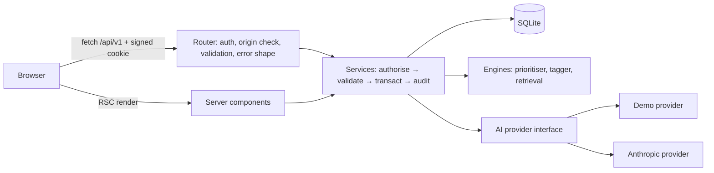
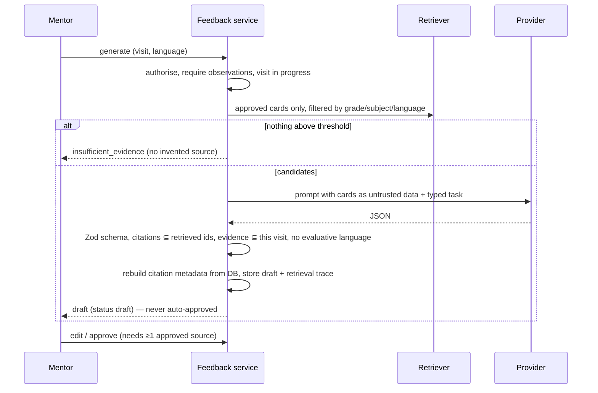

# Architecture

## Shape

One Next.js 16 application (App Router, TypeScript strict, Tailwind v4). The "backend" is Next.js server code: a table-driven REST router under `/api/v1` plus server components that call the same service layer directly. SQLite (Node's built-in `node:sqlite`) stores everything locally.

Business rules live **once**, in `src/lib/services`. The REST routes and the pages both call them, so the UI cannot do anything the API would forbid.

## Why Next.js-only instead of FastAPI

The original specification suggested FastAPI. This environment had no Python, and a single Node process makes the demo one command. The AI/RAG layer sits behind `src/lib/ai` and `src/lib/engines`, so it can later move to a Python service without changing business logic. Postgres can replace SQLite behind the services, which already take a `Db` handle and use plain SQL.

## Why `node:sqlite`

No native module to compile on Windows, no ORM migration runtime. The trade-off is that Node marks the module experimental. Migrations are plain SQL in `src/lib/db/migrations.ts` and are tracked in `schema_migrations`.
SQLite here is a **local-first demo store**. It does not provide multi-device sync, and it has no vector search.

## Request pipeline

1. Router matches `/api/v1/...`, rejects cross-origin mutations and non-JSON bodies.
2. Reads the signed session cookie, loads the actor from the database.
3. Service checks the role policy (`src/lib/auth/policy.ts`) and ownership. Another mentor's visit returns **404** so existence is not leaked; a role that can never do something returns **403**.
4. Zod validates input. Errors return `{ error: { code, message, details } }`.
5. State changes run inside a transaction together with their audit event.

## AI is only ever called from the server

`src/lib/ai/provider.ts` defines one interface. The demo provider is deterministic and flagged `simulated`. The Anthropic provider uses `fetch`, one attempt, a hard timeout, and maps failures (credentials, credits, rate limit, timeout, malformed JSON) to mentor-safe errors. The key is read from the server environment only.

### Feedback pipeline (E3)

## Engines

| Engine | Implementation | Not claimed |
|---|---|---|
| E1 visit prioritiser | Configurable rules → reasons per school | No trained model, no gradient-boosted trees, no teacher ranking |
| E2 observation tagger | Keyword rules against the rubric; suggestions need confirmation | No measured accuracy / Cohen's κ |
| E3 feedback composer | Retrieval + provider + server validation | No measured draft usability |
| E4 demonstration generator | From one approved card; same validation | No learning-gain claim |
| E5 follow-up/report | Deterministic extraction from stored records | AI never finalizes anything |

Retrieval is an explainable keyword score (`src/lib/engines/retrieval.ts`) with the matched terms stored per draft. Vector search is a replaceable `Retriever`; none exists today.

## Design system

Tokens in `src/app/globals.css` (`@theme`), WCAG AA contrast verified numerically by `tests/contrast.test.ts`. Components in `src/components/ui.tsx` and `forms.tsx`. Native `<dialog>` for confirmations, `aria-live` toasts, skip link, visible focus ring, reduced-motion support.
