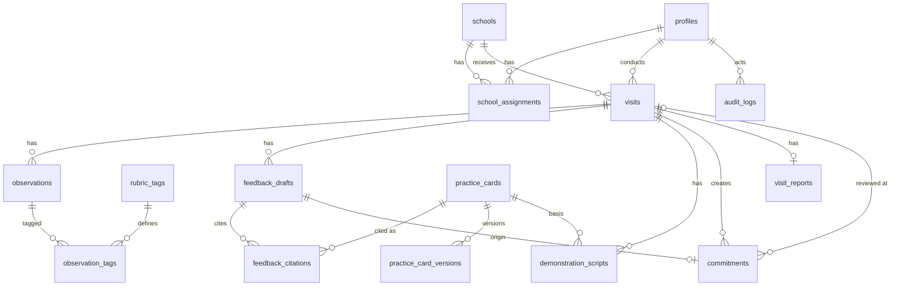

# Data model

SQLite, plain-SQL migrations (`src/lib/db/migrations.ts`), foreign keys on, UUID text ids (practice cards use stable ids such as `R-14`). **There is no student table and no child-level field.**

| Table | Purpose / key rules |
|---|---|
| `profiles` | Role `mentor` / `supervisor` / `diet_admin`, preferred language. |
| `schools`, `school_assignments` | Fictional schools; a mentor may only act on actively assigned schools. |
| `visits` | Status CHECK; `completed` requires `completed_at`. `audio_consent` exists but is always `not_requested`. `previous_commitment_id` links the follow-up chain. |
| `observations` | Length-limited text; no child names. |
| `observation_tags` | `source` mentor/suggested, `confirmed` flag, rule match strength and matched terms. Mentor-typed tags are always confirmed (CHECK). |
| `rubric_tags` | Versioned taxonomy, seeded as demo content that needs domain validation. |
| `practice_cards`, `practice_card_versions` | Approval status; **approved requires reviewer + date** (CHECK). Editing bumps version and returns the card to `draft`. |
| `feedback_drafts` | Status `draft/edited/approved/rejected/superseded/insufficient_evidence`; **approved requires approver, time and all three fields** (CHECK). Partial unique index: one live card per visit. Stores provider, `is_simulated`, retrieval trace. |
| `feedback_citations` | Metadata copied from the card at generation time; primary flag; rank; reason. |
| `demonstration_scripts` | One live script per visit; tied to a card id + version. |
| `commitments` | Stored `open → completed → reviewed` (or `cancelled`). **Due soon / overdue are derived from `target_date` at read time.** `reviewed` requires outcome, reviewer, time and the later review visit (CHECK). One non-cancelled commitment per feedback card. |
| `visit_reports` | One per visit; JSON snapshot of stored records; `finalized` requires reviewer and time. |
| `audit_logs` | **Append-only** (UPDATE/DELETE blocked by triggers). Ids, statuses, counts only. |
| `idempotency_keys` | Replays the stored result of a repeated generation request. |
| `app_settings` | Editable priority-rule configuration. |

Why `commitments.review_visit_id` exists: a later visit records what happened to an earlier commitment, which is what closes the coaching loop.

## Public data and knowledge-base tables (migrations 0002 and 0003)

| Table | Purpose / rules |
|---|---|
| `public_sources` | One row per attempted source: status (`downloaded_and_validated`, `manual_download_needed`, `captcha_or_interaction_blocked`, ...), URL, reference period, geography, licence note, checksum, limitations, `is_active`. |
| `public_indicator_defs` | Indicator label, unit, domain, survey type and a plain-language caveat. |
| `public_indicators` | Long-format values with `geography_level`, `reference_period`, `ci95_half_width`, `value_status`. CHECK: a value is NULL **iff** it is `suppressed`. Unique per (indicator, source, state, area, period). No foreign keys to operational tables. |
| `public_ingestions` | Every import attempt (imported/rejected), validation counts, input checksums. |
| `kb_sources` | Official pedagogy documents: title, publisher, URL, version, licence note, file checksum. |
| `kb_chunks` | Verbatim excerpt (20-900 chars), PDF and printed page, `review_status` (CHECK: reviewed states need a reviewer and time). |
| `practice_card_chunks` | Card to excerpt links (primary / supporting). `practice_cards.origin` is `illustrative` or `official_source`. |
| `feedback_citation_chunks` | Snapshot of the exact excerpt(s) shown with each citation, so approved feedback stays traceable. |

## Added for sync and language (V5, V6)

| Table / column | Purpose |
|---|---|
| `profiles.ui_language` (`0005_ui_language`) | Interface language, separate from `preferred_language` (coaching drafts). NULL until chosen. |
| `sync_operations` (`0006_sync_operations`) | One row per terminal offline operation: `op_id` (PK), `actor_id`, entity, `status` (`applied` or `rejected`), `response` (ids and codes only). Makes retries idempotent. |
| commitments created through sync | `feedback_id` may be NULL (mentor-agreed offline); the audit entry carries `mentor_agreed_without_feedback`. One non-cancelled commitment per visit is enforced in the service. |

Records created offline use client-generated UUIDs as their primary keys, so retries cannot create duplicates.
